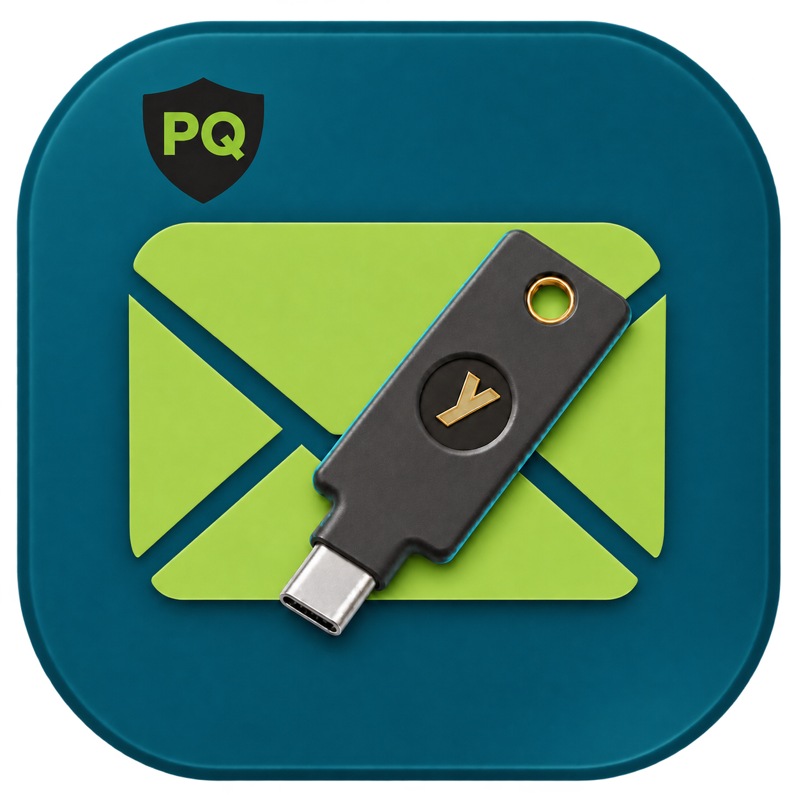

# PQ Mail



PQ Mail is an experimental post-quantum mail application supporting **S/MIME and OpenPGP on macOS, Windows, Linux, Android and iOS**. Desktop and Android use **Jakarta Mail, Eclipse Angus Mail, and Bouncy Castle**; the SwiftUI iOS preview uses **OpenSSL**. Desktop token operations use bundled **PKCS#11** adapters; Android uses **YubiKit 3.3.0** directly. It supports software identities and keys generated and used on a PQC Ready YubiKey. Formerly **Hybrid Mail**, the project now lives at [ve7jtb/pq-mail](https://github.com/ve7jtb/pq-mail).

## Demonstration video

[Watch the Google OAuth and post-quantum S/MIME demonstration](https://youtu.be/RGiaAeGTCmc) (3:20). The desktop demo shows Gmail read/send consent, a YubiKey-signed message, and a signed-and-encrypted message decrypted locally with the YubiKey. It uses ML-DSA-87 + ECDSA P-384 signatures and ML-KEM-1024 + ECDH P-384 encryption. PIN prompts are included with their fields masked; unrelated inbox content and pauses are removed. Recorded November 17, 2026 using synthetic messages sent to the same account. The video is unlisted on YouTube and accessible through this link.

## On-key certificates and migration

Use **Keys → Save certificates on YubiKey…** to carry the pure/hybrid S/MIME
certificates, existing OpenPGP public identity and serial/slot mappings with the
key. **Import certificates from YubiKey…** verifies the bundle and actual public
keys, then asks for review; it does not grant trust. Android and iOS expose the
same save/import/migration actions in their identity screens.

New provisioning uses ECDSA slot **83**, leaving 9a available for authentication.
Existing 9a credentials keep working. The explicit **Migrate signing key 9a → 83…**
action requires an empty destination and management authorization; no migration
happens on update. Save the on-key bundle again after migration. Public storage
contains no PINs, private keys, passwords or Google OAuth refresh tokens.

See [on-key format, workflows and recovery](docs/ON-KEY-CERTIFICATES.md).
**Hardware validation (November 18, 2026):** A YubiKey 6.0.0 Beta0 passed the following tests:

- **On-key bundle:** macOS saved a 24,434-byte signed bundle containing the existing Level 3 pure/hybrid signing and encryption certificates and serial/slot mappings. Read-back through a new PC/SC connection, clean-profile import, restart and duplicate import passed. No private keys were imported and no certificate trust was granted automatically.
- **Slot migration:** the existing P-384 signing key moved from **9a to empty 83**, retaining its public key and PIN Always / Touch Never policies. Slot 9a became empty. Before/after snapshots confirmed all PIV certificates and other keys' public metadata were unchanged. Desktop mappings were updated, and hybrid signing verified the refreshed bundle using slot 83.
- **Android NFC import:** Pixel 10 read the refreshed bundle directly from the key and updated both existing Level 3 identities to **9c / 83 / 9d / 82** (ML-DSA signing / ECDSA signing / ML-KEM decryption / ECDH decryption).
- **NFC S/MIME round trips:** Pixel 10 passed pure **ML-DSA-65 / ML-KEM-768** and hybrid **MLDSA65-ECDSA-P384-SHA512 / MLKEM768-ECDH-P384-SHA3-256** signing and decryption with the imported certificates. Hybrid signing used the saved slot 83 mapping and its composite signature verified. No email was sent.

One pre-PIN NFC retry occurred during hybrid decryption: the public-metadata read
`F7 P2=9C` failed with an IOException after 305 ms; a fresh tap recovered and the
round trip passed. The same trace successfully read slot 83 (`SW=9000`, 28 ms).
These successful tests do not establish that the Pixel 10's intermittent NFC
transport issue is resolved. No saved OpenPGP identity was present in this bundle,
so this hardware run did not validate OpenPGP bundle transfer. Physical iOS bundle
testing remains pending.

## Android preview

An [Android version](android/README.md) uses **YubiKit 3.3.0 directly over USB and NFC**, with the same three software `.p12`, pure PQ, and hybrid profiles. It includes local S/MIME, IMAPS/SMTP, and public-only YubiKey identities. See the Android guide for build instructions, hardware testing, and preview limitations; Google OAuth and token provisioning remain desktop features.

## iOS development preview

The [native SwiftUI iOS preview](ios/README.md) uses **OpenSSL 3.6.5** for Level 2/3/5 pure and hybrid S/MIME, persistent password-protected `.p12` identities, and public YubiKey credential bundles. **OpenPGP is an alternative for Level 3 hybrid identities**, using draft-05 ML-DSA-65 + P-384 / ML-KEM-768 + P-384 profiles, separate OpenPGP public identities and PGP/MIME. Both formats share software primitives and the YubiKit NFC/USB-C raw PIV backend. Tests cover published OpenPGP vectors, simulator round trips, simulated hardware operations, and desktop S/MIME/PKCS#12 interoperability. **Physical iPhone YubiKey testing remains pending.** This local-file preview has no mail accounts/sending or attachments yet; see the iOS README for supported formats and limitations.

## OpenPGP on every platform

Select **OpenPGP (Level 3 hybrid draft)** when composing with a Level 3 hybrid identity. It reuses the software `.p12` keys or existing YubiKey PIV keys for **ML-DSA-65 + ECDSA P-384 signing** and **ML-KEM-768 + ECDH P-384 encryption**. OpenPGP public identities are separate from S/MIME certificates: create/import your own public identity and exchange `.asc` public keys with correspondents. Import the same public identity on another device to preserve its fingerprint.

This implements the experimental draft-05 OpenPGP profiles, not the S/MIME composite encoding. Pure PQ, Level 2 and the existing Level 5 P-384 profiles are not available in OpenPGP. Plain-text signed or signed-and-encrypted PGP/MIME is supported; attachments remain S/MIME-only. See the [OpenPGP guide](docs/OPENPGP.md) for setup, limitations and tests.

## Platform capabilities

| Capability | Desktop (macOS / Windows / Linux) | Android preview | iOS preview |
|---|---|---|---|
| Software `.p12`, Level 2/3/5 pure/hybrid S/MIME | Yes | Yes | Yes |
| Level 3 hybrid OpenPGP | Yes | Yes | Yes |
| YubiKey private-key backend | Bundled PKCS#11 | YubiKit USB/NFC | YubiKit raw PIV NFC/USB-C; physical testing pending |
| Generate four keys on an empty YubiKey | Yes | Use existing keys | Use existing keys |
| Local signed/encrypted `.eml` files | Yes | Yes | Yes |
| S/MIME attachments | Yes | Yes | Not yet |
| Conventional RSA/ECDSA S/MIME | Yes | Yes | Not yet |
| IMAPS inbox / SMTP | Yes | Yes | Not yet |
| Gmail API / Google OAuth | Yes | Not yet | Not yet |
| Persistent certificate trust | Yes | Yes | Verification only; no automatic trust |

OpenPGP validation covers desktop regression tests, eight Android emulator tests (including the simulated PIV adapter), 19 Swift tests, published draft vectors, and bidirectional Java/OpenSSL message exchange. A Level 3 hybrid OpenPGP USB round trip was reported successful by the tester; unlike the saved S/MIME tests, that manual flow did not persist a hardware report. Physical OpenPGP NFC and Windows runtime testing remain pending. Existing S/MIME hardware test results do not constitute OpenPGP hardware validation.

## Desktop features

- Compose signed messages with attachments, optionally encrypt them, and save/open `.eml` files.
- For other hosts, send through SMTP with STARTTLS and show the **10 most recent inbox messages** through read-only IMAP over TLS. Gmail uses its API with 50-message pages and an optional S/MIME-only filter.
- Sign in to Gmail with Google Desktop OAuth, including PKCE and a loopback callback, requesting only Gmail API read-only and send scopes. Save the client configuration and refresh token in **macOS Keychain** or **Windows Credential Manager**.
- Select the outgoing signing identity and recipient encryption certificate independently.
- Manage signing and encryption certificates, inspect SHA-256 fingerprints, export PEM/DER, and explicitly mark certificates trusted. Successfully verified incoming signers can be added to the trust store.
- Keep **software identities in password-protected `.p12` files** separate from **YubiKey identities**, whose private keys stay on the device.
- Remember the serial and slots for each YubiKey identity, prompt for the correct device, and show the algorithm in PIN/operation dialogs.
- Update YubiKey certificate email addresses using the existing keys, including up to four additional email SANs.
- Export certificates with suggested `.pem` filenames or select DER `.cer`; identity and message save dialogs default to `.p12` and `.eml`. Missing extensions are added automatically.

This is an experimental interoperability application. Generated certificates are local test certificates; composite formats and OIDs follow the pinned Bouncy Castle implementation. It is not a production mail client or a claim of interoperability with every S/MIME implementation.

## S/MIME cryptographic profiles

| Profile | Signing | Encryption / KEM |
|---|---|---|
| Level 2 pure | ML-DSA-44 | ML-KEM-768 |
| Level 2 hybrid | MLDSA44-ECDSA-P256-SHA256 | MLKEM768-ECDH-P256-SHA3-256 |
| Level 3 pure | ML-DSA-65 | ML-KEM-768 |
| Level 3 hybrid | MLDSA65-ECDSA-P384-SHA512 | MLKEM768-ECDH-P384-SHA3-256 |
| Level 5 pure | ML-DSA-87 | ML-KEM-1024 |
| Level 5 hybrid | MLDSA87-ECDSA-P384-SHA512 | MLKEM1024-ECDH-P384-SHA3-256 |

Software creation offers the same Level 2, 3 and 5 choices as YubiKey creation. Each creates four software keys and stores both pure and hybrid identities in one password-protected `.p12` bundle; the PQ components are shared between the two views. Importing that bundle restores both selections. The empty-device provisioning flow offers levels 2, 3 and 5. Every option creates four keys and saves both pure and hybrid identities for selection when sending. Level labels refer to the ML-DSA NIST category; ML-KEM-768 is category 3 in both levels 2 and 3. These labels do not claim FIPS validation of the device or application.

Software and YubiKey creation accept up to four additional comma-separated email addresses. All signing and encryption certificates, pure and hybrid, include the primary address plus these `rfc822Name` Subject Alternative Names. The subject CN remains the primary email. Duplicate or invalid addresses are rejected. Pending YubiKey setup metadata preserves the additional addresses for certificate issuance retries.

Outgoing S/MIME messages use opaque CMS SignedData, optionally wrapped in AuthEnvelopedData. PQ encryption uses KEMRecipientInfo, HKDF-SHA256, AES-256 key wrap and AES-256-GCM. Encryption is performed on the host with the recipient's public key; the recipient's YubiKey performs private-key decapsulation and ECDH during decryption. The host combines hybrid secrets.

Bouncy Castle computes ML-DSA external μ, including composite domain separation, and assembles composite signatures. The app's OpenSSL/PKCS#11 adapter uses the provider's external-μ support from [PR #818](https://github.com/openssl-projects/pkcs11-provider/pull/818). Returned signatures are verified before use. A composite operation shares one entered PIN between its two components and clears the cache when the operation finishes; PINs are never persisted.

## Getting started on desktop

1. In **Keys**, select or create a software identity, or select a saved YubiKey identity. Software creation requires a new `.p12` file and a password of at least 12 characters.
2. In **Certificates**, import the recipient's encryption certificate. Check its fingerprint through a trusted channel. Signing-certificate trust is an explicit, separate action.
3. In **Compose**, choose **Sign with**, enter matching sender/recipient addresses, and optionally enable **Also encrypt for recipient** and select **Encrypt to**.
4. Save the message locally or send it with SMTP. Use **Read & verify** for a local message or open a message from **Inbox**.

For Gmail, the desktop app includes a shared **PQ Mail** Google OAuth registration; new installations do not need their own client ID. Choose **Sign in with Google**, then **Connect Gmail**. The shared project is **In production**, so accounts do not need to be added as named test users. Google verification is pending; the unverified-app warning and Google's unverified-user limit still apply. The shared client loads directly from the app without a credential-store read. Older custom registrations can be reselected by importing their JSON in Advanced settings; choose **Inbox → Advanced settings… → Use PQ Mail Google client** to switch, then sign in again. Developers can still import their own Desktop client JSON or use **Advanced settings… → Enter Google client credentials…**. Google connections use the Gmail API with only `gmail.readonly` and `gmail.send`; other hosts retain IMAP/SMTP. Gmail shows 50 header-only messages per page with **Newer/Older** controls for the entire inbox. Message MIME is fetched when opened and is not cached to disk. Refresh tokens restore access after restart; sign-out removes the saved token. Server passwords and YubiKey PINs are not saved. See the [desktop and Gmail guide](docs/DESKTOP.md).

### Android hardware testing

Install the development APK built from `android/`, then open **Identities & certificates**. Import a software bundle, import an existing YubiKey signing/encryption certificate pair, or issue local certificates for an already-provisioned YubiKey. The app stores public token certificates and their serial binding; it does not copy private keys from the device.

To test a saved YubiKey identity:

1. Open **Identities & certificates** and tap the saved pure or hybrid identity. Selection returns to Home.
2. Open **Identities & certificates** again and scroll below the certificate export buttons.
3. Choose **Test selected YubiKey identity — no email**. This button appears only after selecting a YubiKey identity.
4. Connect over USB or follow the fresh-tap prompt and hold the key at the NFC antenna through each operation. Enter the PIN first, then follow the fresh-tap prompt. A round trip normally asks for one signing PIN and one decryption PIN; each composite operation reuses its PIN for both components.

**Android NFC comparison (November 17, 2026):** With the same APK and Level 3 Beta0 YubiKey, Pixel 9 / Android 17 completed **five NFC S/MIME round trips: three hybrid and two pure**, with no recorded pre-PIN retries. Pixel 10 / Android 17 completed one of four hybrid runs in its comparison batch, with three failures and seven recorded pre-PIN setup failures. The Pixel 10 honored the new 240-byte public-metadata response requests, but transport errors persisted. This points toward a phone-dependent NFC interaction, not a proven root cause or universal reliability claim. Earlier Pixel 10 Level 5 pure/hybrid NFC and Level 3 pure/hybrid USB tests also passed. **22 focused emulator tests passed.** See the [YubiKit integration and phone-comparison report](docs/ANDROID-NFC-YUBIKIT.md) for exact scope and limitations.

## YubiKey identities

**Create identity on empty YubiKey…** checks every user PIV slot before asking for provisioning credentials and checks again under an exclusive device connection before generation. Any occupied or unreadable slot stops the operation. The factory attestation slot is excluded. The flow does not reset a device or replace existing keys.

| Slot | Level 2 | Level 3 | Level 5 |
|---|---|---|---|
| `9c` signing | ML-DSA-44 | ML-DSA-65 | ML-DSA-87 |
| `83` signing (new identities) | ECDSA P-256 / SHA-256 | ECDSA P-384 / SHA-384 | ECDSA P-384 / SHA-384 |
| `9d` decryption | ML-KEM-768 | ML-KEM-768 | ML-KEM-1024 |
| `82` decryption | ECDH P-256 | ECDH P-384 | ECDH P-384 |

Composite KEM identifiers follow [draft-ietf-lamps-cms-composite-kem-04](https://datatracker.ietf.org/doc/html/draft-ietf-lamps-cms-composite-kem-04), including MLKEM768-ECDH-P384-SHA3-256. ML-DSA categories are defined in [FIPS 204](https://csrc.nist.gov/pubs/fips/204/final); ML-KEM parameters in [FIPS 203](https://nvlpubs.nist.gov/nistpubs/fips/nist.fips.203.pdf).

Keys are generated on the device with PIN policy **Always** for all four slots. Touch policy is **Always** for ML-DSA signing (9c) and ML-KEM decryption (9d), and **Never** for ECDH (82) and ECDSA (83). This applies to newly generated keys; existing keys and their policies are unchanged. Local identity records contain public certificates, serial and slot bindings, not token private keys. A missing or different device produces a connect/retry prompt. Generation is not atomic: a partial failure leaves generated keys in place and a subsequent creation attempt refuses the nonempty device. **Finish pending certificates…** can resume certificate issuance after successful key generation without generating keys again. Select the saved `setup.properties` file; the app checks the device serial and public keys before issuing certificates. It cannot resume partial key generation. The adjacent **ⓘ** button explains this recovery flow.

**Update YubiKey certificate email…** issues new local signing and encryption certificates for saved token profiles using their existing keys. Enter the primary email and up to four additional comma-separated email SANs; duplicates and invalid addresses are rejected. Old identities are preserved, PIN prompts authorize certificate signing, and no email is sent. This changes certificate identity information, not your Google account.

Desktop provisioning reads the device’s actual beta firmware version through YubiKey Management before opening PIV, allowing Beta0 devices to pass detection while preserving the empty-slot checks.

The packaged provisioning helper uses Yubico's Rust yubikit directly. **ykman is not required for this flow or for PKCS#11 signing/decryption.** The older optional `ykman-mu.py` adapter and Terminal setup scripts still require the Beta0 ykman CLI. See [PKCS#11 signing](docs/PKCS11.md), [KEM decryption](docs/PKCS11-KEM.md), and [external-μ protocol](docs/EXTERNAL-MU.txt).

## Build from source

Use **JDK 25.0.5.1 or newer within the Java 25 GA release line**, **Maven 3.9.9**, Python 3, Git and Bash on macOS/Linux. Initial dependency builds require network access and several GB of disk space. macOS native helpers also require Xcode Command Line Tools and a current Rust toolchain.

```sh
git clone https://github.com/ve7jtb/pq-mail.git
cd pq-mail
# Set JAVA_HOME and PATH for your JDK and Maven.
./scripts/build-dependencies.sh
./build.sh test
./run.sh
```

Dependencies are pinned to these public source revisions:

| Repository | Revision |
|---|---|
| [mail-api](https://github.com/ve7jtb/mail-api) | `09b27cf52b4b382c55cc8736858456f3aa43b369` |
| [angus-mail](https://github.com/ve7jtb/angus-mail) | `d33de7563efdf5a3cb0691994500d6cad8aecafd` |
| [bc-java](https://github.com/ve7jtb/bc-java) | `6b4f58259d2b3ee8301fda1d6c8798f816abc5ea` |

Activation uses `jakarta.activation-api:2.2.0-M2` and `angus-activation:2.1.0-M1`. The dependency script keeps checkouts, caches and logs under `.deps/`, validates existing checkouts, and writes runtime jars to `lib/`. Set `HYBRID_DEPS_DIR` to change the cache location. Upstream dependency test suites are skipped; app tests run with `build.sh test`. Subsequent app-only builds use the local jars. Builds are not claimed to be byte-for-byte reproducible.

### macOS app

```sh
./scripts/build-pkcs11.sh
./package.sh
```

This creates **`dist/PQ Mail.app`**, bundling Java, OpenSSL, PKCS#11 modules, and native provisioning/Keychain helpers. Python 3 must be installed on the Mac; its path is configurable. `HYBRID_OPENSSL_ROOT` selects OpenSSL (default `/opt/homebrew/opt/openssl@3`); `HYBRID_MAIL_PACKAGE_DIR` selects the output directory. Existing app images are not overwritten. The development app is ad-hoc signed, not notarized.

### Windows x64 and ARM64

The [Windows installer workflow](https://github.com/ve7jtb/pq-mail/actions/workflows/windows-installers.yml) builds on separate x64 and ARM64 runners and packages Java, Python, OpenSSL, the PKCS#11 provider/module and native helpers. Successful runs publish architecture-specific `PQ-Mail-Windows-*` installer artifacts. These are development installers, not Authenticode-signed releases. See [Windows build instructions and validation status](docs/WINDOWS.md). A configured workflow alone is not evidence of a successful installer or hardware test; check the run result and artifacts.

### Android APK

After building the pinned shared dependencies above, set `ANDROID_HOME` to an SDK with platform **37.0** installed:

```sh
cd android
./gradlew :app:assembleDebug
# app/build/outputs/apk/debug/app-debug.apk
```

The build pins AGP 9.3.3, Gradle 9.7.1 and YubiKit 3.3.0. The APK supports API 26 and later; testing so far used a Pixel 10 running Android 17. This is a debug-signed preview. Android uses Activation 2.1.3 / Angus Activation 2.0.2 for runtime compatibility. See the [Android guide](android/README.md) for installation, device tests, storage behavior and limitations.

### Compatibility with existing installations

The display name and repository changed to PQ Mail. Existing settings, identity references, trust records and OAuth credential-store identifiers remain compatible. The application deliberately retains the legacy **`Hybrid Mail`** data directory (`~/Library/Application Support/Hybrid Mail` on macOS and `%LOCALAPPDATA%\Hybrid Mail` on Windows), Java package names, helper filenames and `HYBRID_*` environment variables. No key regeneration or credential migration is needed for the rename.

## S/MIME attachments

In desktop Compose, use **Add attachments…** and **Remove selected**. Files and the text body are signed together. Enable **Also encrypt for recipient** to encrypt the complete signed message, including attachment filenames and contents, using the selected PQ, hybrid, or conventional recipient certificate. Gmail API and SMTP use the same protected message. Outer email headers remain unprotected.

For signed mail, signature verification must succeed before attachments are available. Decrypted-only mail is explicitly labeled unsigned, and its attachments carry no signer assurance. Decrypted attachments remain in memory until you explicitly save one. Desktop saving refuses to overwrite existing files; Android uses the system save dialog. The composer supports up to 20 attachments and a combined body/file payload of 10 MiB, subject to the final 20 MiB encoded-message limit. Android also supports attachment selection and saving through the system document picker.

## Conventional S/MIME interoperability

RSA and ECDSA signatures can be received and explicitly trusted by certificate fingerprint. Recipient encryption certificates support RSA (2048 bits or larger) and ECDH P-256/P-384 alongside PQ KEM profiles. Key usage and emailProtection extended key usage are checked when present; an ECDH certificate requires keyAgreement when key usage is present. Trust for signing and encryption is separate and does not imply CA-chain validation.

Import a recipient certificate or use **Trust signer for encryption** on verified mail if the signer certificate also permits encryption. A separate encryption certificate must be imported when the signing certificate is signing-only. Conventional software `.p12` files with one unambiguous signing key and at most one encryption key can be imported, including arbitrary aliases. Classical decryption requires the matching software private key; PQ YubiKey profiles remain unchanged.

The reader accepts signed messages inside AuthEnvelopedData or conventional EnvelopedData (including AES-CBC), and plain-text content in common mixed/alternative/related MIME layouts. HTML is not rendered. Encrypted messages without a signature are shown explicitly as unsigned and cannot be used to establish signer trust. Encryption to a conventional recipient does not provide post-quantum confidentiality, even when the message carries a PQ signature.


## Share certificates between instances

Select a saved **YubiKey identity**, then choose **Share certificates…** (Mac: **Keys**; Android: **Identities & certificates**). PQ Mail gathers the saved pure/hybrid profiles for the same device and PQ key pair and shows the email addresses, algorithms, fingerprints, serial and all four PIV slots before sharing. A normal pure/hybrid pair contains four public certificates. If only one profile is saved, only that profile can be shared; no new certificates or keys are generated.

The versioned `.pqcert` bundle contains public signing/encryption certificates and YubiKey serial/slot mappings. It contains **no private keys, PINs, passwords, OAuth credentials or trust decisions**. The Mac opens its native sharing picker, including AirDrop when available, and also offers **Save bundle…**. Android opens its system share sheet, including Quick Share when available. Transport availability depends on the OS/device; this feature does not implement AirDrop itself.

On the receiving Mac, open the `.pqcert` file with PQ Mail or use **Import certificate bundle…**. On Android, share/open it with PQ Mail when offered, or select it with **Import certificate bundle…**. Review all fingerprints and device mappings, then choose:

- **Use with my YubiKey / My YubiKey**: save public-only identities for that device. Select the imported pure or hybrid identity afterward. The existing signing/decryption backend checks serial and public keys when the key is used; imported metadata alone does not prove possession.
- **Add contact certificates / Contact certificates**: save certificates for another person's mailbox. Mark fingerprints trusted separately after confirming them with the owner.

Existing trust decisions are preserved, but imports never grant new trust. Repeated identity imports are idempotent; conflicting existing bindings are rejected. No YubiKey slots are written or provisioned. ML-DSA signing currently uses slot `9c`; the traditional-signing, ML-KEM and ECDH mappings travel with each profile. Software private identities remain separate `.p12` imports.

Validation covers public-only bundle round trips, malformed/oversized input, conflicting mappings, idempotent imports, trust separation, Android provider access restrictions and simulated token operations. Physical Mac–Android AirDrop/Quick Share delivery still requires testing on the two devices.

## Validation and limitations

- **Current Level 3 hardware:** physical Beta0 tests passed on macOS through PKCS#11 for ML-DSA-65 / ML-KEM-768 and MLDSA65-ECDSA-P384-SHA512 / MLKEM768-ECDH-P384-SHA3-256. All four keys were generated on-device with PIN Always / Touch Never. Both signed-and-encrypted S/MIME round trips passed. The new pure/hybrid public certificate pairs were copied into Android and independently read back byte-for-byte. Subsequent Android NFC round trips passed for both profiles.
- **Android software and adapter tests:** five instrumented test groups passed on Pixel 10 / Android 17, covering all six profiles, encrypted `.p12` reload, wrong-password rejection, tampering, UI startup, and actual YubiKit PIV code exercised with a simulated APDU card. Desktop PQ Mail decrypted and verified 12 Android-generated messages and loaded the corresponding `.p12` bundles. Physical Level 3 NFC round trips also passed; physical Level 3 pure and hybrid USB round trips passed twice each.
- **Earlier hardware tests:** physical Beta0 hardware tests passed for pure ML-DSA-65 and composite MLDSA65-RSA3072-PSS-SHA512 signing through PKCS#11, and pure ML-KEM-768 / hybrid MLKEM768-ECDH-P256 decryption. Saved messages were independently reopened and verified. The earlier ykman external-μ signing demo also passed.
- Automated tests cover software profiles, simulated external signing/decryption including all three provisioning levels in pure and hybrid modes, serialization, tampering, key matching, PIN cache cleanup, identity bindings, and provisioning refusal/partial failures. Simulators do not establish physical-device support. Level 2 and Level 5 pure physical hardware round trips remain unverified; the Level 5 hybrid Gmail demonstration below passed; the normal provisioning UI requires an empty compatible key.
- Gmail API OAuth with the shared client and read/send scopes was observed in the Mac app: 12 inbox messages loaded, with 3 matching the S/MIME-only filter. Mock API tests cover paging and pure/hybrid signed/encrypted MIME transfer for all three levels. On November 17, 2026, two synthetic self-addressed messages were sent and received through the live Gmail API: one signed and one signed-and-encrypted. MLDSA87-ECDSA-P384-SHA512 signatures verified, and MLKEM1024-ECDH-P384-SHA3-256 YubiKey decryption completed with authenticated AES-256-GCM decryption. Earlier full-mail OAuth, Keychain restoration after restart, and the ten-message IMAP inbox were also observed. Live SMTP delivery, third-party interoperability, Windows hardware use and a production security audit are not established by these tests.
- The reader accepts opaque and detached signatures, AuthEnvelopedData and conventional EnvelopedData, common text MIME layouts, and attachments. Encrypted-only messages are explicitly labeled unsigned; signature or decryption failures are not downgraded. HTML rendering is not supported.
- **Attachment and conventional interoperability tests:** desktop regression tests and Android emulator tests passed for binary/Unicode-named attachments in all six PQ profiles, RSA/ECDSA signatures, RSA/ECDH encryption, arbitrary-alias software `.p12` import, detached signatures, AES-GCM and legacy AES-CBC envelopes, and unsigned encrypted messages. These are local generated-message tests, not independent third-party client or physical YubiKey validation of the new features.
- Trust uses exact certificate fingerprints, validity and key-usage checks. There is no CA chain building or revocation checking. Outer mail headers are not signed or encrypted. The app distinguishes signature validity from trust and flags sender/certificate mismatches.

Public demonstration certificates are separately published in [hybrid-mail-test-certificates](https://github.com/ve7jtb/hybrid-mail-test-certificates). Private keys, user identity files, device identifiers, user OAuth tokens, custom client credentials and local hardware artifacts are excluded from this source repository.

## Source map

The Android UI, USB/NFC backend, build instructions and instrumentation tests are under `android/`. Its build reuses the canonical S/MIME sources and substitutes Android platform adapters.

Desktop Java code is under `src/dev/hybridmail/`: `MailApp` is the Swing UI; `MailEngine` handles S/MIME and mail transport; `Identity` and `DesktopState` manage identities and storage; `ExternalMu` / `ExternalKem` bridge token operations; `TokenProvision` invokes the native provisioning helper. `adapters/` contains the Python OpenSSL/PKCS#11 and legacy ykman adapters. `native-src/` contains platform credential helpers and Rust provisioning code. Tests are in the Java sources, `tests/`, and the Rust helper.

Third-party components retain their own licenses; see [notices](docs/THIRD-PARTY.txt). No project license has been selected yet.

Gmail **S/MIME only** filters each page using its top-level Content-Type (opaque S/MIME and multipart/signed with a PKCS#7 signature protocol). It does not fetch message bodies or establish signature validity. Pages cover 50 inbox entries before filtering, so a page may show fewer or no matches while **Older** remains available. S/MIME nested inside forwarded messages or ordinary attachments is not included.

### Bundled Java security baseline

Desktop builds require Java 25.0.5.1 or newer in the Java 25 GA line. Set `JAVA_HOME` to that JDK; compilation, dependency builds and packaging reject older runtimes and early-access builds. Windows CI pins Azul Zulu 25.0.5.1 (November 2026 security update). Mac and Windows packaging also check the actual bundled runtime and produce a `java-runtime*.txt` report alongside the package. Updating system Java does not update an already installed PQ Mail app; replace the app with the rebuilt package.

This baseline includes the November Base64 intrinsic fix (CVE-2026-114938); see [Azul’s November release notes](https://docs.azul.com/core/release-notes). Android uses ART and iOS uses OpenSSL, so this desktop JDK change does not replace their runtimes.

### Linux amd64 and ARM64

Linux builds provide a `.deb` installer and a portable `.tar.gz` app image for each architecture. They target Ubuntu 24.04 or newer (glibc 2.39+), bundle patched Java 25.0.5.1, OpenSSL 3.5.9 LTS, the PKCS#11 provider/module and YubiKey provisioning helper. No system JDK or ykman is required. Install the Debian package with `sudo apt install ./PQ-Mail-1.2.1-Linux-amd64.deb` (use `arm64` for ARM). The desktop menu entry launches PQ Mail.

The portable archive requires Python 3, PC/SC (`pcscd`, `libccid`, `libpcsclite1`), GTK/X11/font libraries and `libsecret-1-0`. Run `PQ Mail/bin/PQ Mail` after extraction. A graphical desktop session is required; Wayland desktops need XWayland for Java Swing. Enable the distribution’s PC/SC service/socket if it is not active. Do not run PQ Mail as root.

Settings and identities use `$XDG_DATA_HOME/pq-mail`, normally `~/.local/share/pq-mail`. Google OAuth refresh tokens and custom client credentials use the desktop Secret Service (for example GNOME Keyring or a compatible KWallet service); there is no plaintext fallback. The keyring must be available and unlocked. Software `.p12` passwords and YubiKey PINs are not saved. Certificate sharing uses file export/import on Linux.

The Linux workflow builds natively on amd64 and ARM64, tests software S/MIME/OpenPGP and simulated token operations, tests a disposable Secret Service store/read/delete cycle, and runs the software profiles in the packaged JVM. Physical YubiKey operation on Linux still requires hardware testing. Build with `scripts/build-dependencies.sh`, `build.sh test`, `scripts/build-linux-native.sh`, and `scripts/package-linux.sh`; see `.github/workflows/linux-packages.yml` for the build prerequisites.

Linux 1.2.1 validation (November 18, 2026): native Ubuntu 24.04 amd64 and ARM64 [build/profile/Secret Service tests](https://github.com/ve7jtb/pq-mail/actions/runs/44366025968) passed. Both `.deb` packages passed checksum verification, installation and desktop-window startup in [clean-runner installation tests](https://github.com/ve7jtb/pq-mail/actions/runs/44368695400). Download the `.deb` and portable archive from the build run’s `PQ-Mail-Linux-amd64` or `PQ-Mail-Linux-arm64` artifacts. These checks use synthetic software identities and simulated token operations; they do not establish physical Linux YubiKey compatibility.

The ARM64 Debian package was also installed in the local **Codex Linux** UTM VM (Ubuntu 26.04.1 ARM64). Level 2/3/5 pure/hybrid software identity round trips passed in the installed bundled JVM, and the installed desktop window opened under Xvfb as the normal non-root user. No accounts, email or physical YubiKey were used.
